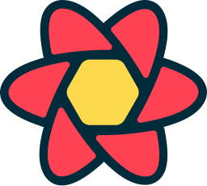
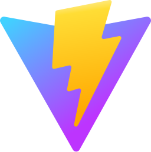

  <h1>
    Привет   
    
     
    Меня зовут Влад и я
  </h1>

  

---

## 👨‍💻 О себе

<table>
  <tr>
    <td width="60%">
      <h3>🎯 Сейчас в фокусе Fullstack-разработка</h3>
      <ul>
        <li><b>Опыт:</b> В коммерческой разработке с 2021 года. Основной опыт связан с React, TypeScript и Next.js.</li>
        <li><b>Frontend:</b> Свободно проектирую сложные потоки данных как в легковесных стейтах (Zustand), так и в крупных enterprise-архитектурах на базе MobX и Redux Toolkit, обеспечивая предсказуемый Data Flow и высокую производительность рендеринга.</li>
        <li><b>Backend & DB:</b> Развиваюсь в бэкенд-разработке на Node.js и NestJS. Проектирую реляционные базы данных (PostgreSQL) и схемы данных через Prisma ORM.</li>
        <li><b>Инфраструктура:</b> Конфигурирую процессы автоматизации, контейнеризирую приложения с помощью Docker и настраиваю пайплайны автоматической сборки и деплоя в GitLab CI/CD.</li>
        <li><b>Цель:</b> Стремлюсь к профессиональному росту как Fullstack разработчик.</li>
      </ul>
    </td>
    <td width="40%" align="center">
      
    </td>

  </tr>
</table>

---

## 🛠️ Стек технологий

  &nbsp;
  &nbsp;
  &nbsp;
  &nbsp;
  &nbsp;
  &nbsp;
  &nbsp;
  &nbsp;
  &nbsp;
  &nbsp;
  &nbsp;
  &nbsp;
  &nbsp;
  &nbsp;
  &nbsp;
  

---

## 📫 Связаться со мной

