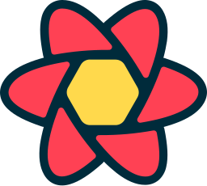
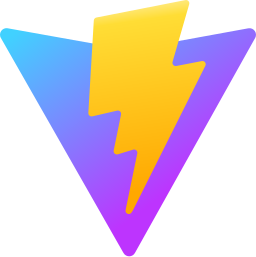

  <h1>
    Привет   
    
     
    Меня зовут Влад и я
  </h1>

  

---

## 👨‍💻 О себе

<table>

  <tr>
    <td width="60%">
      <h3>🎯 Специализируюсь на Frontend-разработке: React, Next.js (App Router) и TypeScript. Делаю упор на чистую архитектуру, строгую типизацию и предсказуемую работу с данными.</h3>
      <ul>
        <li><b>Опыт:</b> С 2025 года. Основной стек — React, TypeScript и Next.js</li>
        <li><b>Frontend:</b> Проектирую архитектуру приложений и управляю потоками данных. Умею работать как с крупными стейт-менеджерами (Redux Toolkit), так и с более легковесными решениями (Zustand). Фокусируюсь на производительности рендеринга, оптимизации Next.js (SSR, ISR) и чистоте кодовой базы по методологии FSD.</li>
        <li><b>Backend & DB:</b> Активно начал развивать Fullstack. Пишу бэкенд-логику на Node.js, проектирую реляционные базы данных (PostgreSQL) и управляю схемами данных через Prisma ORM.</li>
        <li><b>Инфраструктура:</b> Настраиваю сборку проектов (Vite, Webpack), контейнеризирую приложения в Docker. Собирал пайплайны сборки и деплоя в GitLab CI/CD.</li>
        <li><b>Цель:</b> Ищу позицию Junior Frontend / Fullstack разработчика, где смогу решать сложные архитектурные задачи на стыке фронтенда и бэкенда.</li>
      </ul>
    </td>
    <td width="40%" align="center">
      
    </td>

  </tr>
</table>

---

## 🛠️ Стек технологий

  &nbsp;
  &nbsp;
  &nbsp;
  &nbsp;
  &nbsp;
  &nbsp;
  &nbsp;
  &nbsp;
  &nbsp;
  &nbsp;
  &nbsp;
  &nbsp;
  &nbsp;
  &nbsp;
  

---

## 📫 Связаться со мной

